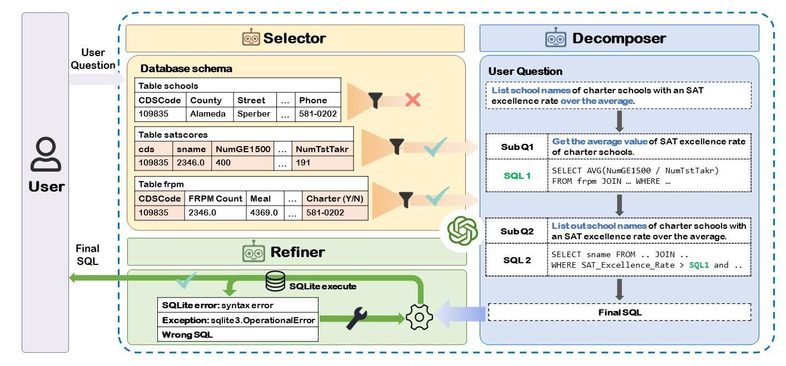

## 📖Introduction

In this paper, we propose a multi-agent collaborative Text-to-SQL framework MAC-SQL, which comprises three agents: the **Selector**, the **Decomposer**, and the **Refiner**.



## 🔧 Data Preparation

In order to prepare the data more quickly, I have packaged the files including the databases of the BIRD dataset and the Spider dataset into `data.zip` and uploaded them. 
All files were downloaded on December 19, 2023, ensuring they are the latest version at that moment. 
The download links are available on [Baidu Disk](https://pan.baidu.com/s/1jU2li3d-enhzswx8VdNYdg?pwd=hfmk) and [Google Drive](https://drive.google.com/file/d/1kkkNJSmJkZKeZyDFUDG7c4mnkxsrr-om/view?usp=sharing)(update on 2024-04-22).

After downloading the `data.zip` file, you should delete the existing data folder in the project directory and replace it with the unzipped data folder from `data.zip`.

## 🌟 Project Structure

```txt
├─data # store datasets and databases
|  ├─spider
|  ├─bird
├─core
|  ├─agents.py       # define three agents class
|  ├─api_config.py   # OpenAI API ENV config
|  ├─chat_manager.py # manage the communication between agents
|  ├─const.py        # prompt templates and CONST values
|  ├─llm.py          # api call function and log print
|  ├─utils.py        # utils function
├─scripts            # sqlite execution flask demo
|  ├─app_bird.py
|  ├─app_spider.py
|  ├─templates
├─evaluation # evaluation scripts
|  ├─evaluation_bird_ex.py
|  ├─evaluation_bird_ves.py
|  ├─evaluation_spider.py
├─bad_cases
|  ├─badcase_BIRD(dev)_examples.xlsx
|  └badcase_Spider(dev)_examples.xlsx
├─evaluation_bird_ex_ves.sh # bird evaluation script
├─README.md
├─requirements.txt
├─run.py # main run script
├─run.sh # generation and evaluation script
```

## 👍Contributing

We welcome contributions and suggestions!
